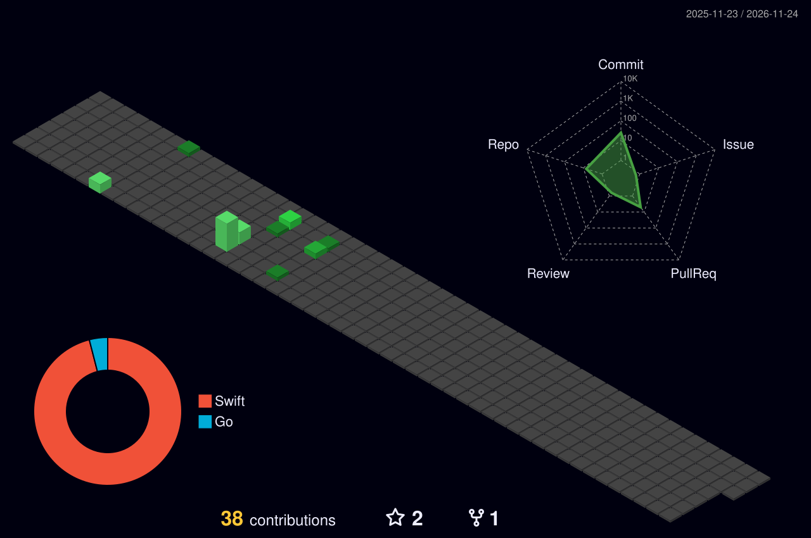

  

  

 

---

## 📊 GitHub Stats

  
  

  

  

## 🐍 Contribution Snake

  <picture>
    <source media="(prefers-color-scheme: dark)" srcset="https://raw.githubusercontent.com/zero9211/zero9211/output/github-snake-dark.svg" />
    <source media="(prefers-color-scheme: light)" srcset="https://raw.githubusercontent.com/zero9211/zero9211/output/github-snake.svg" />
    
  </picture>

## 📊 3D Contribution Graph

  

---

<!-- TRENDING-X-START -->

<h2>🐦 X (Twitter) 今日热议 Top 10</h2>

| # | 热门话题 | 讨论量 |
|:---:|:---|---:|
| 🥇 | [Chargers](https://twitter.com/search?q=Chargers) | — |
| 🥈 | [Ravens](https://twitter.com/search?q=Ravens) | — |
| 🥉 | [Zay Flowers](https://twitter.com/search?q=Zay%20Flowers) | — |
| 4️⃣ | [Derrick Henry](https://twitter.com/search?q=Derrick%20Henry) | — |
| 5️⃣ | [#WWERaw](https://twitter.com/search?q=%23WWERaw) | — |
| 6️⃣ | [Herbert](https://twitter.com/search?q=Herbert) | — |
| 7️⃣ | [Brissett](https://twitter.com/search?q=Brissett) | — |
| 8️⃣ | [Mike McDaniel](https://twitter.com/search?q=Mike%20McDaniel) | — |
| 9️⃣ | [#BoltUp](https://twitter.com/search?q=%23BoltUp) | — |
| 🔟 | [Minter](https://twitter.com/search?q=Minter) | — |

🕐 更新于 2026-11-17 13:40 CST &nbsp;·&nbsp; 数据来源: trends24.in
<!-- TRENDING-X-END -->

<!-- TRENDING-SUBSTACK-START -->

<h2>📰 Substack 热门文章 Top 10</h2>

> ⚠️ 暂时无法获取 Substack 热门数据，稍后重试

🕐 更新于 2026-11-17 13:40 CST &nbsp;·&nbsp; 数据来源: substack.com
<!-- TRENDING-SUBSTACK-END -->

<!-- TRENDING-GITHUB-START -->

<h2>⭐ GitHub 热门项目 Top 10</h2>

| # | 项目 | ⭐ Stars | 语言 | 简介 |
|:---:|:---|:---:|:---:|:---|
| 🥇 | [ag-ui-protocol/ag-ui](https://github.com/ag-ui-protocol/ag-ui) | 19333 | `TypeScript` | AG-UI: the Agent-User Interaction Protocol. Bring Agents into Frontend A… |
| 🥈 | [backnotprop/plannotator](https://github.com/backnotprop/plannotator) | 12721 | `TypeScript` | The workspace to stay in the loop and on top of agents - shape, decide, … |
| 🥉 | [dream-num/univer](https://github.com/dream-num/univer) | 27945 | `TypeScript` | Build your own AI office with Univer Office SDK. Bring editing, calculat… |
| 4️⃣ | [tradermonty/claude-trading-skills](https://github.com/tradermonty/claude-trading-skills) | 6496 | `Python` | Claude Code skills for equity investors and traders — market analysis, t… |
| 5️⃣ | [elementalsouls/Claude-BugHunter](https://github.com/elementalsouls/Claude-BugHunter) | 7655 | `Python` | A Claude Code skill bundle for bug hunting and external red-team work - … |
| 6️⃣ | [getarcaneapp/arcane](https://github.com/getarcaneapp/arcane) | 8879 | `Go` | Modern Docker Management, Designed for Everyone |
| 7️⃣ | [DeanChensj/jiangshan-map](https://github.com/DeanChensj/jiangshan-map) | 7132 | `JavaScript` | 江山时序 · 中国历史交互地图时间轴 (403 BCE – Present) | Interactive Historical Atlas of… |
| 8️⃣ | [google-labs-code/stitch-skills](https://github.com/google-labs-code/stitch-skills) | 9810 | `TypeScript` | A library of Agent Skills designed to work with the Stitch MCP server. E… |
| 9️⃣ | [mvanhorn/last30days-skill](https://github.com/mvanhorn/last30days-skill) | 68300 | `Python` | AI agent skill that researches any topic across Reddit, X, YouTube, HN, … |
| 🔟 | [NVIDIA/SkillEvaluator](https://github.com/NVIDIA/SkillEvaluator) | 2917 | `Python` | Multi-tier framework for evaluating AI agent skills and plugins with qua… |

🕐 更新于 2026-11-17 13:40 CST &nbsp;·&nbsp; 数据来源: github.com/trending
<!-- TRENDING-GITHUB-END -->

---

## 📈 Activity Graph

  

  

