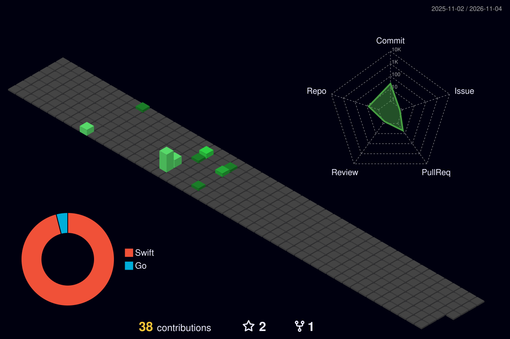

  

  

 

---

## 📊 GitHub Stats

  
  

  

  

## 🐍 Contribution Snake

  <picture>
    <source media="(prefers-color-scheme: dark)" srcset="https://raw.githubusercontent.com/zero9211/zero9211/output/github-snake-dark.svg" />
    <source media="(prefers-color-scheme: light)" srcset="https://raw.githubusercontent.com/zero9211/zero9211/output/github-snake.svg" />
    
  </picture>

## 📊 3D Contribution Graph

  

---

<!-- TRENDING-X-START -->

<h2>🐦 X (Twitter) 今日热议 Top 10</h2>

> ⚠️ 暂时无法获取 X 热门数据，稍后重试

🕐 更新于 2026-11-04 11:51 CST &nbsp;·&nbsp; 数据来源: trends24.in
<!-- TRENDING-X-END -->

<!-- TRENDING-SUBSTACK-START -->

<h2>📰 Substack 热门文章 Top 10</h2>

> ⚠️ 暂时无法获取 Substack 热门数据，稍后重试

🕐 更新于 2026-11-04 11:51 CST &nbsp;·&nbsp; 数据来源: substack.com
<!-- TRENDING-SUBSTACK-END -->

<!-- TRENDING-GITHUB-START -->

<h2>⭐ GitHub 热门项目 Top 10</h2>

| # | 项目 | ⭐ Stars | 语言 | 简介 |
|:---:|:---|:---:|:---:|:---|
| 🥇 | [thedotmack/claude-mem](https://github.com/thedotmack/claude-mem) | 112073 | `TypeScript` | Persistent Context Across Sessions for Every Agent – Captures everything… |
| 🥈 | [vercel-labs/agent-desktop](https://github.com/vercel-labs/agent-desktop) | 13125 | `Rust` | Computer use CLI for AI agents |
| 🥉 | [max-sixty/worktrunk](https://github.com/max-sixty/worktrunk) | 10582 | `Rust` | Worktrunk is a CLI for Git worktree management, designed for parallel AI… |
| 4️⃣ | [JustVugg/colibri](https://github.com/JustVugg/colibri) | 47328 | `C` | A hierarchical inference engine for frontier MoE models: hot experts on … |
| 5️⃣ | [mattpocock/skills](https://github.com/mattpocock/skills) | 311631 | `Shell` | Skills for Real Engineers. Straight from my .agents directory. |
| 6️⃣ | [p-e-w/heretic](https://github.com/p-e-w/heretic) | 38896 | `Python` | Training-free language model modification: Remove censorship, suppress s… |
| 7️⃣ | [spotify/portal-ai-plugins](https://github.com/spotify/portal-ai-plugins) | 3075 | `TypeScript` | — |
| 8️⃣ | [floci-io/floci](https://github.com/floci-io/floci) | 28920 | `Java` | Light, fluffy, and always free - The AWS Local Emulator alternative |
| 9️⃣ | [Usagi-org/ai-goofish-monitor](https://github.com/Usagi-org/ai-goofish-monitor) | 16648 | `Python` | 基于 Playwright 和AI实现的闲鱼多任务实时/定时监控与智能分析系统，配备了功能完善的后台管理UI。帮助用户从闲鱼海量商品中，找到心仪… |
| 🔟 | [anomalyco/hex](https://github.com/anomalyco/hex) | 4679 | `Rust` | Local voice dictation for mac, windows and linux |

🕐 更新于 2026-11-04 11:51 CST &nbsp;·&nbsp; 数据来源: github.com/trending
<!-- TRENDING-GITHUB-END -->

---

## 📈 Activity Graph

  

  

