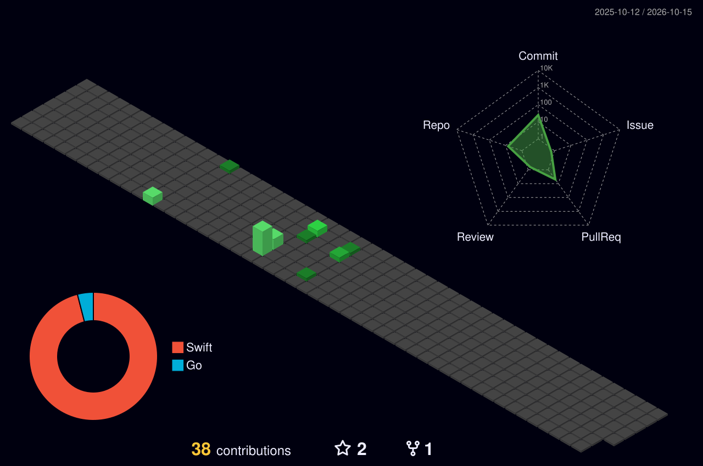

  

  

 

---

## 📊 GitHub Stats

  
  

  

  

## 🐍 Contribution Snake

  <picture>
    <source media="(prefers-color-scheme: dark)" srcset="https://raw.githubusercontent.com/zero9211/zero9211/output/github-snake-dark.svg" />
    <source media="(prefers-color-scheme: light)" srcset="https://raw.githubusercontent.com/zero9211/zero9211/output/github-snake.svg" />
    
  </picture>

## 📊 3D Contribution Graph

  

---

<!-- TRENDING-X-START -->

<h2>🐦 X (Twitter) 今日热议 Top 10</h2>

> ⚠️ 暂时无法获取 X 热门数据，稍后重试

🕐 更新于 2026-10-27 10:51 CST &nbsp;·&nbsp; 数据来源: trends24.in
<!-- TRENDING-X-END -->

<!-- TRENDING-SUBSTACK-START -->

<h2>📰 Substack 热门文章 Top 10</h2>

> ⚠️ 暂时无法获取 Substack 热门数据，稍后重试

🕐 更新于 2026-10-27 10:51 CST &nbsp;·&nbsp; 数据来源: substack.com
<!-- TRENDING-SUBSTACK-END -->

<!-- TRENDING-GITHUB-START -->

<h2>⭐ GitHub 热门项目 Top 10</h2>

| # | 项目 | ⭐ Stars | 语言 | 简介 |
|:---:|:---|:---:|:---:|:---|
| 🥇 | [Nutlope/hallmark](https://github.com/Nutlope/hallmark) | 36606 | `CSS` | Anti-AI-slop design skill for Claude Code, Cursor, and Codex. |
| 🥈 | [TauricResearch/TradingAgents](https://github.com/TauricResearch/TradingAgents) | 116255 | `Python` | TradingAgents: Multi-Agents LLM Financial Trading Framework |
| 🥉 | [JetBrains/thinkrail](https://github.com/JetBrains/thinkrail) | 3030 | `TypeScript` | Vibe code with pi in a lightweight, real IDE that customises itself arou… |
| 4️⃣ | [makecindy/cindy](https://github.com/makecindy/cindy) | 6629 | `TypeScript` | Consider it done. The open-source AI agent that works out of the box · 想… |
| 5️⃣ | [affaan-m/ECC](https://github.com/affaan-m/ECC) | 289930 | `JavaScript` | The agent harness performance optimization system. Skills, instincts, me… |
| 6️⃣ | [pbakaus/impeccable](https://github.com/pbakaus/impeccable) | 89317 | `Rust` | The design language that makes your AI harness better at design. |
| 7️⃣ | [NVIDIA/SkillSpector](https://github.com/NVIDIA/SkillSpector) | 22298 | `Python` | Security scanner for AI agent skills. Detect vulnerabilities, malicious … |
| 8️⃣ | [pollen-robotics/microduck](https://github.com/pollen-robotics/microduck) | 12474 | `Rust` | A Tiny biped duck robot 🦆 |
| 9️⃣ | [nightly-labs/openbot](https://github.com/nightly-labs/openbot) | 1548 | `TypeScript` | A local-first desktop workspace for persistent AI teammates. Run Codex, … |
| 🔟 | [Panniantong/Agent-Reach](https://github.com/Panniantong/Agent-Reach) | 103767 | `Python` | Give your AI agent eyes to see the entire internet. Read & search Twitte… |

🕐 更新于 2026-10-27 10:51 CST &nbsp;·&nbsp; 数据来源: github.com/trending
<!-- TRENDING-GITHUB-END -->

---

## 📈 Activity Graph

  

  

